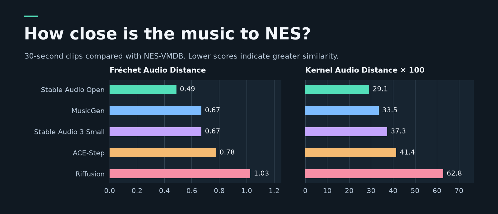
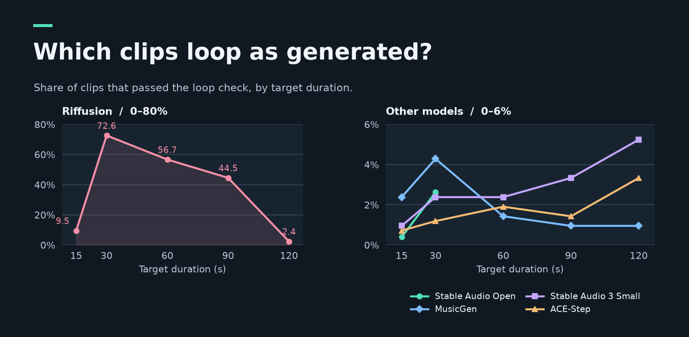
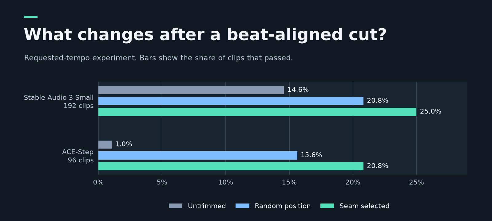
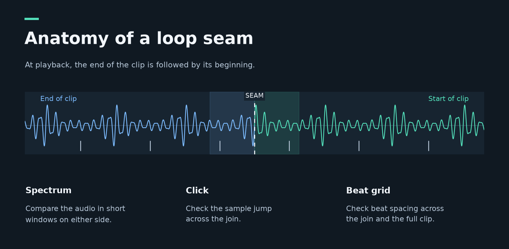

# Loopable Game Music

Code and data for *Evaluation and Preparation of Generated Background Music for Computer Games* by **Semyon Davshits and Svetlana Loseva**, Bauman Moscow State Technical University.

We evaluated **5 music generation models on 8,736 clips** in the style of NES game music. The benchmark measures similarity to the NES corpus, generation time, peak GPU memory, and how often a clip passes an audio and rhythm check for looping. A separate experiment measures how much trimming on beat boundaries improves that pass rate.

## Benchmark results

- **Stable Audio Open** produced the closest match to the NES corpus on both audio distance metrics.
- **Stable Audio 3 Small** was the fastest model tested. It generated 30 seconds of audio in 0.7 seconds at the median on an RTX 3060.
- **Riffusion** had the highest pass rate as generated, reaching 72.6% at 30 seconds. The four other models peaked at 5.2% or less.

| Model | FAD | KAD × 100 | Time (s) | Peak GPU memory (GB) | Best untrimmed pass rate |
| --- | ---: | ---: | ---: | ---: | ---: |
| Stable Audio Open 1.0 | **0.49** | **29.1** | 26 | 5.6 | 2.6% at 30 s |
| MusicGen-small | 0.67 | 33.5 | 52 | **1.7** | 4.3% at 30 s |
| Stable Audio 3 Small | 0.67 | 37.3 | **0.7** | **1.7** | 5.2% at 120 s |
| ACE-Step v1 3.5B | 0.78 | 41.4 | 6.4 | 8.0 | 3.3% at 120 s |
| Riffusion v1 | 1.03 | 62.8 | 37 | 3.1 | **72.6% at 30 s** |

Fréchet Audio Distance (FAD) and Kernel Audio Distance (KAD) compare the distributions of audio features against NES-VMDB. Lower values indicate greater similarity. The distances, median generation time, and peak memory are for 30-second clips. The last column gives each model's highest pass rate across the durations tested.



### Loopability by duration

Riffusion's pass rate fell from **72.6% at 30 seconds** to **2.4% at 120 seconds**. The pattern is consistent with most Riffusion clips clustering around 93.9 BPM. Stable Audio Open was tested at 15 and 30 seconds. The panels use different vertical scales so the differences among the other four models remain visible.



### Beat-aligned trimming

In the requested-tempo experiment, beat-aligned trimming with seam selection raised the pass rate from **14.6% to 25.0%** for Stable Audio 3 Small and from **1.0% to 20.8%** for ACE-Step. The median lengths of the accepted segments were 8.7 and 7.8 seconds, respectively.

The random baseline sampled a position in the clip while keeping the same number of beats. Spectral seam selection showed no statistically significant advantage over that baseline.



## How a loop is checked



1. **Screen the clip.** Flag excessive silence, noise-like audio, and nearly static signals.
2. **Check the seam.** Compare spectra in 50 ms and 200 ms windows and measure the sample jump where playback wraps around.
3. **Check the beat grid.** Give the beat tracker context from both ends of the clip, then check the total length and the beat spacing across the join.

The check accepted **47 of 75** held-out NES loops (62.7%). The filter was calibrated on NES music and can reject quieter clips that sound fine on repeat. Use the results to shortlist clips for a listening check.

## Reproduce the results

### Verify the paper's numbers

The verification script uses the Python standard library. It checks the tables, statistical comparisons, and control results against the published observations.

```bash
git clone https://github.com/SeMe4K-0/loopable-game-music.git
cd loopable-game-music
python verify.py
```

### Check an audio file

Install the dependencies with Python 3.11. The command prints a JSON report. `--cut` also evaluates the best beat-aligned segment found, and `--output` saves that segment if it passes.

```bash
python -m pip install -r requirements.txt
python -m src.eval.check_audio input.wav --cut --output candidate.wav
```

The [reproduction protocol](docs/reproduction.md) covers generation, FAD and KAD calculation, and calibration. These steps may require the original audio, the model weights, or both.

### Rebuild the figures

Install Matplotlib in the same environment and regenerate the PNGs from the repository data.

```bash
python -m pip install matplotlib
python -m scripts.plot_readme
```

## Repository layout

| Path | Contents |
| --- | --- |
| [data/](data/) | Per-clip observations, control loops, and summaries. See the [data dictionary](data/README.md) for field definitions. |
| [configs/](configs/) | Models, prompts, target durations, random seeds, and screening thresholds |
| [src/eval/](src/eval/) | Loop evaluation, beat-aligned trimming, and the requested-tempo experiment |
| [src/metrics/](src/metrics/) | Seam, beat grid, and audio-feature metrics |
| [src/stage0/](src/stage0/) | NES control loops and click-threshold calibration |
| [verify.py](verify.py) | Numerical verification of the paper |
| [figures/](figures/) | Charts and the loop seam diagram |

## Citation

> Davshits, S. A., and Loseva, S. S. *Evaluation and Preparation of Generated Background Music for Computer Games.*

Citation metadata is available in [CITATION.cff](CITATION.cff).
