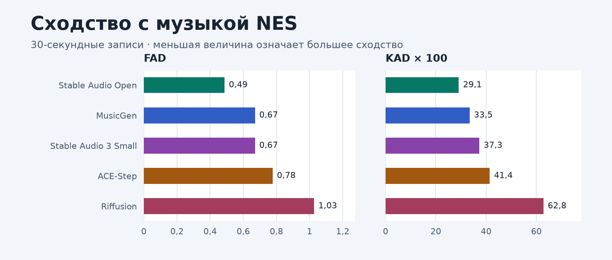
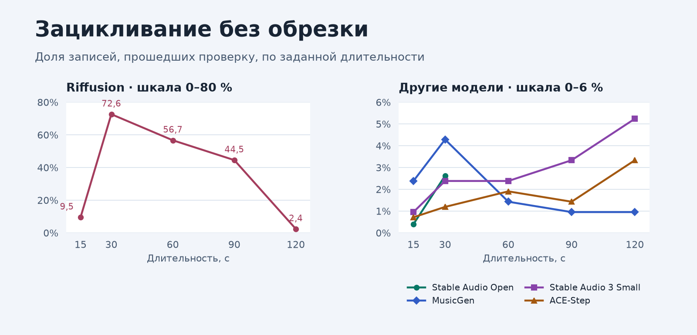
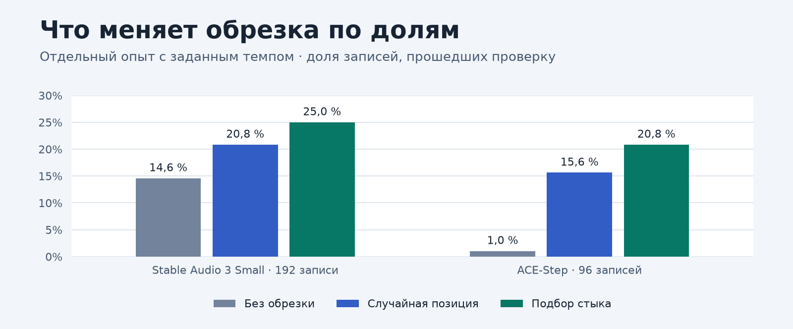

# Loopable Game Music

Код и данные к статье «Оценка и подготовка сгенерированной фоновой музыки для компьютерных игр».

**Семён Давшиц и Светлана Лосева** · МГТУ им. Н. Э. Баумана

Мы сравнили **5 моделей на 8 736 записях** в стиле музыки NES. Измерили сходство с игровым корпусом, время генерации, потребление видеопамяти и долю фрагментов, которые прошли проверку зацикливания. В отдельном опыте проверили, сколько записей можно подготовить к повтору обрезкой по долям.

## Основные результаты

- **Stable Audio Open** ближе всего к корпусу NES по FAD и KAD.
- **Stable Audio 3 Small** быстрее остальных моделей в этом прогоне. Генерация 30 секунд аудио заняла 0,7 с по медиане на RTX 3060.
- **Riffusion** чаще остальных проходил проверку без обработки, особенно при 30 и 60 с. У четырёх других моделей доля принятых записей при любой проверенной длительности составила не более 5,2 %.

| Модель | FAD | KAD × 100 | Время, с | Видеопамять, ГБ | Лучшая доля без обрезки |
| --- | ---: | ---: | ---: | ---: | ---: |
| Stable Audio Open 1.0 | **0,49** | **29,1** | 26 | 5,6 | 2,6 % (30 с) |
| MusicGen-small | 0,67 | 33,5 | 52 | **1,7** | 4,3 % (30 с) |
| Stable Audio 3 Small | 0,67 | 37,3 | **0,7** | **1,7** | 5,2 % (120 с) |
| ACE-Step v1 3.5B | 0,78 | 41,4 | 6,4 | 8,0 | 3,3 % (120 с) |
| Riffusion v1 | 1,03 | 62,8 | 37 | 3,1 | **72,6 % (30 с)** |

FAD (Fréchet Audio Distance) и KAD (Kernel Audio Distance) сравнивают распределения аудиопризнаков с корпусом NES-VMDB. Меньшие значения соответствуют большему сходству с корпусом. Обе метрики, медианное время генерации и пик видеопамяти приведены для 30-секундных записей. Последний столбец показывает лучшую проверенную длительность для каждой модели.



### Доля готовых петель по длительности

Доля принятых записей Riffusion менялась от **72,6 % при 30 с** до **2,4 % при 120 с**. Это согласуется с тем, что темп большинства записей держался около 93,9 BPM. Stable Audio Open проверяли на 15 и 30 с.



### Обрезка по долям

В отдельном опыте с заданным темпом обрезка с подбором стыка увеличила долю принятых записей **с 14,6 до 25,0 %** у Stable Audio 3 Small и **с 1,0 до 20,8 %** у ACE-Step. У принятых фрагментов медианная длительность составила 8,7 и 7,8 с соответственно.

Для сравнения обрезали записи в случайной позиции, сохраняя то же число долей. Статистически значимого преимущества спектрального подбора позиции не обнаружили.



## Как проверяется петля

1. Фильтр отсеивает записи с большим количеством тишины, шумоподобным или почти неизменным звуком.
2. Проверка стыка учитывает спектральный разрыв на окнах 50 и 200 мс и скачок сигнала между концом и началом.
3. Для проверки ритма запись повторяется на границах. Полученная долевая сетка позволяет проверить длину фрагмента и интервал через стык.

На отложенном контроле алгоритм принял **47 из 75** настоящих петель NES (62,7 %). Фильтр настраивали на музыку NES, поэтому он может отклонять спокойные записи, пригодные на слух. Проверка помогает выбрать кандидатов для прослушивания.

## Воспроизведение

### Сверить результаты статьи

Нужен Python. Скрипт читает опубликованные наблюдения и сверяет таблицы, статистические сравнения и результаты контроля. Дополнительные пакеты и веса моделей не нужны.

```bash
git clone https://github.com/SeMe4K-0/loopable-game-music.git
cd loopable-game-music
python verify.py
```

### Проверить свою запись

Установите зависимости в среду Python 3.11. Программа выводит отчёт в JSON. С флагом `--cut` проверяется также обрезка по долям. Флаг `--output` сохраняет фрагмент, если он прошёл проверку.

```bash
python -m pip install -r requirements.txt
python -m src.eval.check_audio input.wav --cut --output candidate.wav
```

Команды для повторной генерации, пересчёта FAD/KAD и калибровки проверки описаны в [протоколе воспроизведения](docs/reproduction.md). Для повторного прогона понадобятся исходное аудио или веса выбранной модели, в зависимости от этапа.

## Где что лежит

| Путь | Содержимое |
| --- | --- |
| [data/](data/) | Наблюдения по записям, контрольные петли и сводки. Поля описаны в [паспорте данных](data/README.md). |
| [configs/](configs/) | Список моделей, промпты, длительности, сиды и пороги фильтра |
| [src/eval/](src/eval/) | Проверка и обрезка записей, опыт с заданным темпом |
| [src/metrics/](src/metrics/) | Метрики стыка, долевой сетки и аудиопризнаков |
| [src/stage0/](src/stage0/) | Контрольные петли NES и калибровка порога щелчка |
| [verify.py](verify.py) | Сверка результатов статьи |
| [figures/](figures/) | Графики по опубликованным данным |

Для повторного построения графиков установите Matplotlib в среду с зависимостями проекта и запустите `python -m scripts.plot_readme`.

## Цитирование

> Давшиц С. А., Лосева С. С. Оценка и подготовка сгенерированной фоновой музыки для компьютерных игр.

Метаданные для библиографических менеджеров доступны в [CITATION.cff](CITATION.cff).
